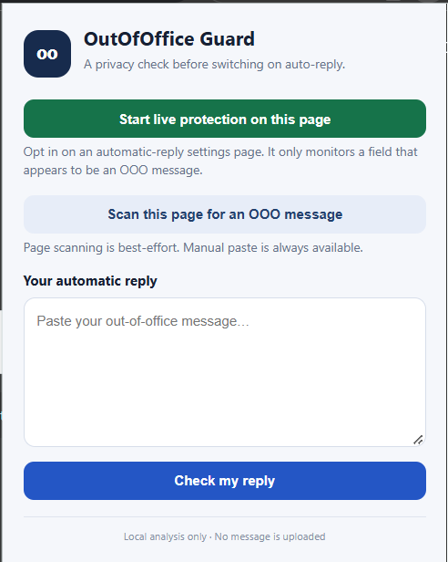
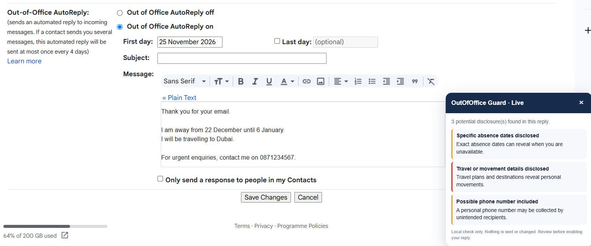
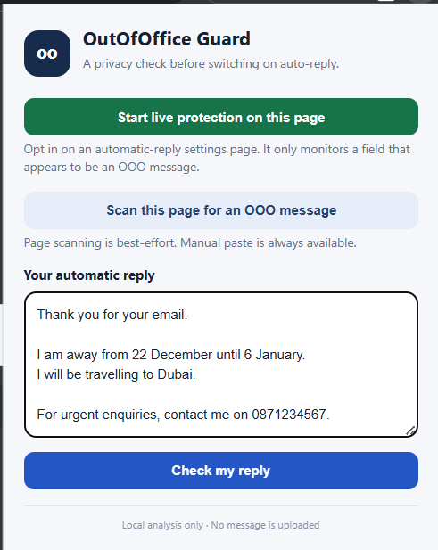
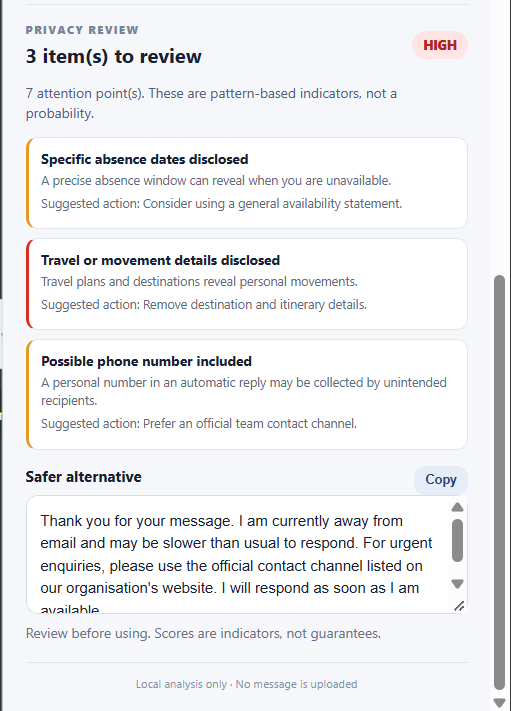
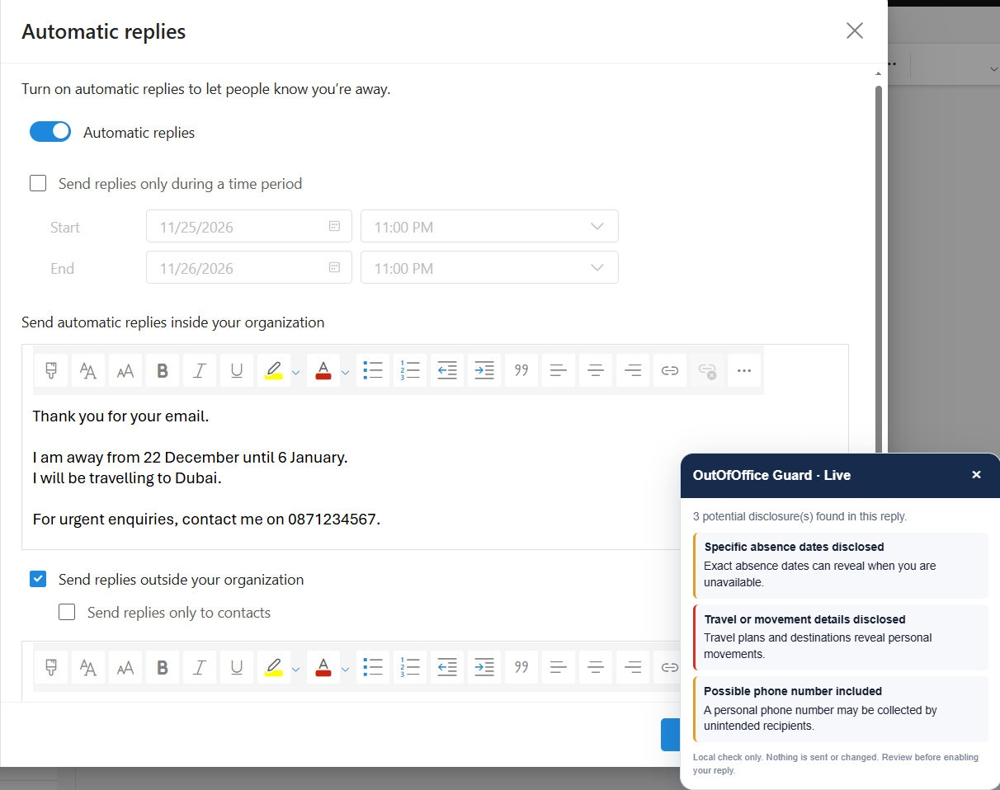

# OutOfOffice Guard

**A privacy-first Chrome extension that checks out-of-office (OOO) replies for potentially sensitive disclosures.**

OutOfOffice Guard helps people review automatic replies before enabling them. It looks for patterns that may reveal precise absence dates, travel plans, personal contact details, unattended-property information, internal operational details, or credential-like strings.

> **Status:** v1.2.1 — tested by the project author in their Chrome environment with Gmail and Outlook settings pages. This is an experimental, heuristic-based MVP, not a security guarantee or a formally validated provider integration.

## What it does

- **Manual review:** paste an automatic reply into the extension popup and run a local pattern check.
- **Best-effort page scan:** ask the extension to look for a visible field whose surrounding page text appears to identify it as an OOO / automatic-reply field.
- **Opt-in live protection:** explicitly start monitoring on the current tab. A small panel checks a recognised field as it is edited.
- **Safer wording suggestion:** the popup proposes a generic alternative for the user to review and copy.
- **Local-first processing:** the extension contains no backend and does not intentionally transmit message text to a remote service.

## Product Demonstration

Watch OutOfOffice Guard detect potentially sensitive information in automatic replies.

[▶ Watch the demonstration video](demo/OutOfOffice-Guard-Demo.mp4)

## Screenshots

### Extension Popup

The main interface for manually checking an out-of-office message.

### Live Protection — Gmail

Real-time detection while editing a Gmail Vacation Responder message.

### Manual Message Analysis

Enter an automatic reply and run a manual security check.

### Security Findings

Review detected disclosures, attention level, explanations and safer wording.

### Live Protection — Outlook

Real-time detection while editing an Outlook Automatic Replies message.

## Install locally (developer mode)

1. Download or clone this repository.
2. Open `chrome://extensions` in Google Chrome.
3. Enable **Developer mode**.
4. Select **Load unpacked**.
5. Choose the repository directory — the directory containing `manifest.json`.
6. Pin OutOfOffice Guard from the Extensions menu if desired.

To update a loaded unpacked extension, replace the files and select **Reload** on its card in `chrome://extensions`.

## Use it

### Manual check

1. Open the extension popup.
2. Paste a sample OOO reply into **Your automatic reply**.
3. Select **Check my reply**.
4. Review each finding and the suggested alternative. Nothing is changed or sent for you.

### Best-effort page scan

1. Open the relevant OOO settings page.
2. Open the extension popup and select **Scan this page for an OOO message**.
3. If a likely field is found, review the extracted text in the popup before analysing it.
4. If no field is found, use manual paste instead.

### Live protection

1. Open the relevant OOO settings page.
2. Open the extension popup and select **Start live protection on this page**.
3. The extension injects `live.js` into the current tab after this explicit action.
4. If a likely OOO field is recognised, the on-page panel checks its text as you type.
5. Close the panel to stop the current live session. After a page refresh, start protection again if needed.

**Testing safety:** use dummy text. Do not enter real passwords, active tokens, or other live secrets for testing. Do not enable or save a test automatic reply.

## Detection coverage

The popup and live monitor use separate, overlapping rule sets. They are not identical.

| Pattern category | Popup manual analysis | Live monitor |
|---|:---:|:---:|
| Specific absence date ranges in an absence context | Yes | Yes |
| Travel / movement wording | Yes | Yes |
| Possible phone number | Yes | Yes |
| Unattended home / property wording | Yes | Yes |
| Internal operational terms | Yes | Yes |
| Personal webmail address | Yes | No |
| Credential / secret-like phrase | Yes | Yes |

The popup assigns attention points and a low / medium / high label. These are rule-based indicators, not probabilities or calibrated risk scores. Live mode presents findings without the popup's combined attention-point score.

See [`docs/DETECTION-RULES.md`](docs/DETECTION-RULES.md) for more detail.

## Architecture

This is a small Manifest V3 extension with no backend:

- `manifest.json` declares the extension metadata, popup, and two permissions.
- `popup.html` and `styles.css` provide the popup interface.
- `popup.js` implements manual analysis, the best-effort page scan, and user-triggered live injection.
- `live.js` identifies likely OOO fields, observes relevant page changes and input events, and renders a floating panel inside a closed Shadow DOM.

See [`docs/ARCHITECTURE.md`](docs/ARCHITECTURE.md).

## Permissions and privacy

The manifest requests:

- `activeTab` — temporary access to the active tab after the user invokes the extension.
- `scripting` — required to run the page-scan function and inject `live.js` after the user clicks the relevant popup control.

The manifest does **not** declare broad host permissions, mailbox/API access, storage, or background service-worker permissions. The extension does not need account credentials and does not connect to Gmail or Microsoft APIs.

The code in this repository contains no intentional remote message-upload or analytics implementation. Page scanning reads candidate field text into the extension popup locally; live mode reads recognised field text in the page context to perform local checks. Review the full source and privacy document before relying on it.

See [`docs/PERMISSIONS.md`](docs/PERMISSIONS.md) and [`docs/PRIVACY.md`](docs/PRIVACY.md).

## Limitations and responsible use

- Detection is based on regular expressions and surrounding-page text heuristics. It can produce false positives and false negatives.
- A clean result does not prove that a message is safe.
- Live field identification depends on page markup and accessible labels. Gmail, Outlook, and other providers can change their interfaces; results may vary by account, layout, browser version, or embedded frame.
- Live mode and popup mode do not have identical detection coverage.
- Page scanning is best-effort and may not work on browser-internal pages, restricted pages, or some cross-origin frames.
- The extension does not activate, edit, save, or send an automatic reply. The user remains responsible for reviewing and enabling their reply.
- Do not use it as a substitute for organisational security review, DLP controls, or professional security advice.

## Development and contribution

The project is plain HTML, CSS, and JavaScript. No build step or package installation is required. Load the repository root as an unpacked extension in Chrome to test changes.

Please include reproducible steps, browser version, provider/page context, and expected versus actual behaviour when reporting bugs. Never include real automatic-reply contents, passwords, access tokens, or personal data in an issue.

## Licence

This project is licensed under the MIT License. See [`LICENSE`](LICENSE).

Copyright (c) 2026 Siddhesh Sachin Chakor.

## Extension icons

The Chrome extension uses the branded PNG assets in `icons/` at 16, 32, 48 and 128 pixels. These are declared in the Manifest V3 `icons` and `action.default_icon` fields.
